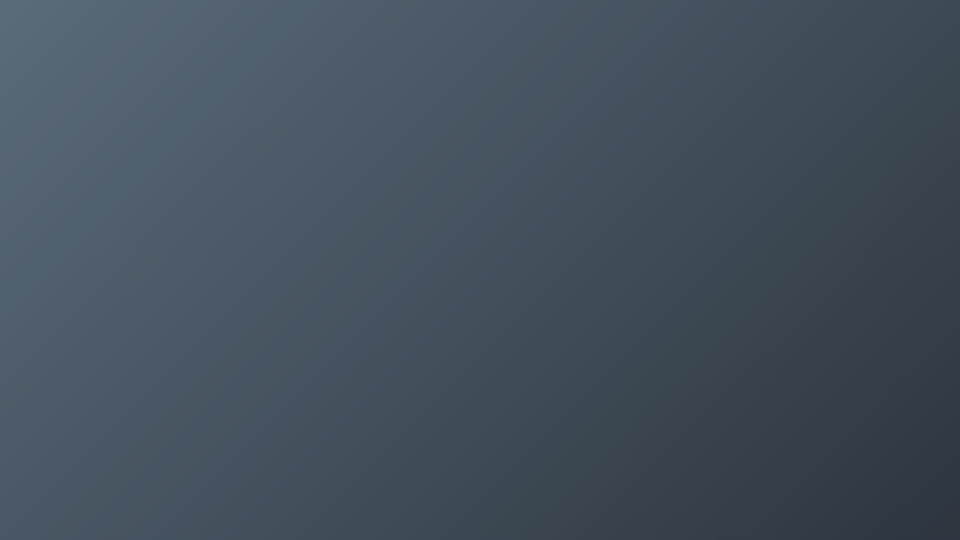

# Sticker Graphics Free — OGraf titles for DaVinci Resolve

Three free animated titles for **DaVinci Resolve 21+**: a lower third, a chapter card and a callout.
There are no Fusion macros and no plugins. Each one is a standard **[OGraf](https://ograf.ebu.io)**
graphic, the open HTML graphics format from the EBU, which Resolve loads natively.

| Graphic | What it does |
|---|---|
| `lower-third` | A label, a name and a role that writes itself on |
| `chapter-card` | The chapter number, a title and a rule that draws across |
| `callout` | An arrow that draws itself to any point on screen, with a label and a pulsing ring |

## Install

1. Download this repo (**Code → Download ZIP**) and unzip it.
2. In Resolve, drag a graphic's `.ograf.json` file into the **Media Pool**.
3. Put it on a track above your footage, then edit the text and colours in the **Inspector**.

Keep each folder intact. The `.ograf.json` file needs the `.mjs` files and the `fuentes/` folder
(fonts) next to it.

## Make it yours

- **Brand colours.** Every graphic has three colour fields: Accent, Ink and Card.
- **Look.** Type `sticker`, `flat` or `soft`. Resolve 21.1 shows option fields as text boxes, so the
  options are written in each field's name, and upper or lower case doesn't matter.
- **Dark preset.** Set Card `#141414`, Ink `#fffaf0` and Accent `#7a96ff`.

## Good to know

- **Frame-accurate.** The animation depends only on the playhead position, so you get the same frame
  on every render, including when you scrub backwards.
- **Built for 16:9.** On vertical timelines, Resolve 21.1 draws OGraf graphics in a 16:9 strip at the
  top of the frame. Move the clip with Transform.
- **Live use.** The graphics implement the OGraf v1 live actions (play, update and stop), so OGraf
  live tools should be able to drive them. They are tested in Resolve and in a browser renderer.
- **Fonts included.** Archivo, Fraunces and JetBrains Mono, all under the SIL Open Font License.

## Want more?

**[Sticker Graphics](https://novaire.gumroad.com/l/auyqt)** is the full pack: 14 graphics in the
same style. On top of these three, it has a big stat, a quote, steps, a subscribe CTA, a definition
card, a source tag, a progress bar, social handles, pros & cons, a countdown and a logo bug.

## License

The graphics are under the [MIT License](LICENSE.txt). The fonts in `fuentes/` are under the SIL
Open Font License 1.1 (see `fuentes/OFL.txt`).
